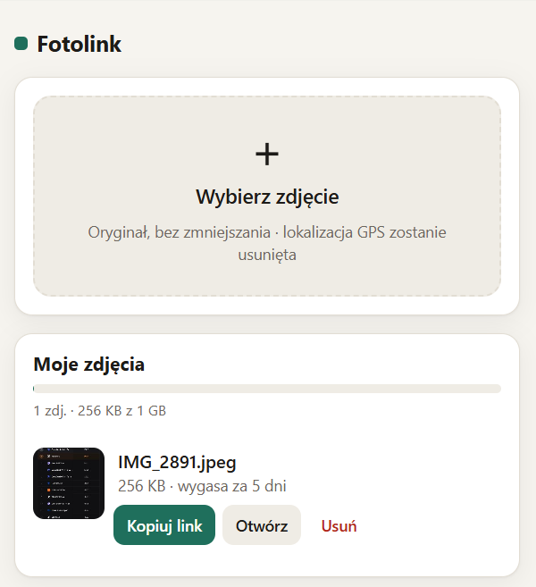

# Fotolink
Fotolink to prywatny, mobilny odpowiednik imgur na Firebase (plan Spark, 0 zł). Wrzucam zdjęcie z telefonu w oryginalnej jakości i dostaję unikalny link z terminem ważności. Plik jest dzielony na części po 1 MB w Firestore i sklejany z kontrolą SHA-256. Przed wysłaniem usuwana jest lokalizacja GPS, a wysyłać mogę tylko ja.



# Fotolink: prywatny „mini-imgur” na Firebase (plan Spark, 0 zł)

Wrzucasz zdjęcie z telefonu i dostajesz unikalny link, który możesz komuś wysłać. Osoba z linkiem widzi zdjęcie i może je pobrać.

- Zdjęcie trafia w **oryginale**, bez zmniejszania i bez ponownej kompresji.
- **Lokalizacja GPS jest usuwana** przed wysłaniem. Piksele zostają nietknięte, a orientacja i dane aparatu zostają.
- **Sharding:** plik jest dzielony na części po 1 MB, zapisywany w Firestore i przy odczycie sklejany z kontrolą sumy SHA-256.
- **Wygasanie linku** po 1, 7, 30 albo 90 dniach.
- Wysyłać może **tylko Ty**: logowanie kontem Google i blokada w regułach bazy.
- Całość działa w darmowym planie **Spark**, bez podpinania karty, więc nigdy nie dostaniesz rachunku.

---

## Instrukcja krok po kroku

Potrzebujesz konta Google (Gmail), komputera (Windows, Mac albo Linux) i około 30–45 minut.

### Krok 1. Zainstaluj Node.js

1. Wejdź na https://nodejs.org i pobierz wersję **LTS**. Zainstaluj ją z domyślnymi ustawieniami.
2. Otwórz terminal:
   - **Windows:** menu Start, wpisz „PowerShell” i otwórz.
   - **Mac:** Spotlight (⌘ + spacja), wpisz „Terminal” i otwórz.
3. Wpisz polecenie:
   ```
   node -v
   ```
   Jeśli zobaczysz numer wersji (np. `v24.x.x`), wszystko jest w porządku.

### Krok 2. Utwórz projekt Firebase

1. Wejdź na https://console.firebase.google.com i zaloguj się swoim kontem Google.
2. Kliknij **Utwórz projekt** (lub „Dodaj projekt”).
3. Wpisz nazwę, np. `fotolink`. Pod nazwą pojawi się **identyfikator projektu**, np. `fotolink-3f2a1`. **Zapisz go**, przyda się w kroku 6.
4. **Google Analytics:** wyłącz, bo nie jest potrzebne. Potem kliknij **Utwórz projekt**.
5. Projekt startuje w planie **Spark** (bezpłatnym). Nie klikaj „Uaktualnij” i nie podawaj karty.

### Krok 3. Dodaj aplikację internetową (web)

1. Na stronie głównej projektu kliknij ikonę **`</>`** (Web / Sieć).
2. Wpisz pseudonim aplikacji, np. `fotolink`.
3. **Zaznacz pole „Skonfiguruj też Hosting Firebase dla tej aplikacji”.** To ważne.
4. Kliknij **Zarejestruj aplikację**.
5. Kolejne ekrany (kod SDK, instalacja CLI) możesz przeklikać przyciskiem **Dalej** i na końcu **Przejdź do konsoli**. Niczego nie musisz stamtąd kopiować, bo aplikacja pobierze konfigurację sama.

### Krok 4. Włącz logowanie przez Google

1. W menu po lewej wybierz **Kompilacja (Build) → Authentication** i kliknij **Rozpocznij**.
2. Zakładka **Metoda logowania** → **Google**.
3. Przełącz **Włącz**, wybierz swój adres w polu „Adres e-mail pomocy” i kliknij **Zapisz**.

### Krok 4a. Dodaj adres strony do logowania Google (ważne!)

Bez tego kroku logowanie kończy się błędem **„400: redirect_uri_mismatch”**.

1. Otwórz https://console.cloud.google.com/apis/credentials i u góry wybierz swój projekt.
2. W sekcji **Identyfikatory klientów OAuth 2.0** kliknij **Web client (auto created by Google Service)**.
3. W **Autoryzowane źródła JavaScript** kliknij **+ Dodaj URI** i wpisz `https://TWOJ-PROJEKT.web.app`.
4. W **Autoryzowane identyfikatory URI przekierowania** kliknij **+ Dodaj URI** i wpisz `https://TWOJ-PROJEKT.web.app/__/auth/handler`.
5. Kliknij **Zapisz**. Zmiana zaczyna działać po kilku minutach, czasem dłużej.

### Krok 5. Utwórz bazę Firestore

1. W menu po lewej wybierz **Kompilacja (Build) → Firestore Database** i kliknij **Utwórz bazę danych**.
2. Jeśli konsola pyta o edycję, wybierz **Standard**.
3. **Lokalizacja:** wybierz `europe-central2 (Warszawa)`. Tej lokalizacji nie da się później zmienić.
4. Wybierz **tryb produkcyjny** i kliknij **Utwórz**. Reguły bezpieczeństwa wgrasz za chwilę z pliku.

### Krok 6. Wpisz swoje dane w 3 plikach

Otwórz pliki w edytorze tekstu. Polecam darmowy **Visual Studio Code** (https://code.visualstudio.com), bo widzi też ukryte pliki.

| Plik | Co zmienić |
|---|---|
| `.firebaserc` | `WPISZ_ID_PROJEKTU` zamień na ID z kroku 2, np. `fotolink-3f2a1` |
| `firestore.rules` | `TWOJ_ADRES@gmail.com` zamień na swój adres Gmail |
| `public/js/config.js` | `TWOJ_ADRES@gmail.com` zamień na **ten sam** adres Gmail |

> Plik `.firebaserc` zaczyna się od kropki, więc na Macu i Linuksie jest domyślnie ukryty. W VS Code (*File → Open Folder*) widać go normalnie.

Adres musi być kontem, którym logujesz się do Google. To on decyduje, kto może wysyłać zdjęcia.

### Krok 7. Zainstaluj narzędzie Firebase i zaloguj się

W terminalu wpisz:

```
npm install -g firebase-tools
```

(Na Macu lub Linuksie, jeśli pojawi się błąd uprawnień, użyj: `sudo npm install -g firebase-tools` i podaj hasło do komputera.)

Następnie wpisz:

```
firebase login
```

Otworzy się przeglądarka. Zaloguj się **tym samym kontem Google** i zezwól na dostęp. Pytanie o zbieranie statystyk (Gemini/usage) możesz odrzucić: `n`.

### Krok 8. Wgraj aplikację

W terminalu przejdź do folderu z projektem. To folder, w którym leży plik `firebase.json`. Przykładowo:

```
cd Dokumenty/fotolink
```

Wgraj stronę i reguły bezpieczeństwa:

```
firebase deploy --only hosting,firestore:rules
```

Na końcu zobaczysz linię `Hosting URL: https://twoj-projekt.web.app`. **To adres Twojej strony.**

Teraz włącz automatyczne kasowanie wygasłych zdjęć (TTL) i wyłącz niepotrzebne indeksowanie danych zdjęć:

```
firebase deploy --only firestore:indexes
```

> Jeśli to polecenie zgłosi błąd, przejdź do sekcji **Rozwiązywanie problemów → TTL**. Aplikacja i tak działa, bo wygasłe zdjęcia są blokowane natychmiast i sprzątane przy każdym otwarciu Twojej strony.

### Krok 9. Sprawdź, czy wszystko działa

1. Na telefonie otwórz `https://twoj-projekt.web.app`.
2. Kliknij **Zaloguj się przez Google** i wybierz swoje konto.
3. Kliknij **Wybierz zdjęcie**, wybierz czas ważności i kliknij **Wyślij**.
4. Skopiuj link i otwórz go w **oknie prywatnym (incognito)**, żeby zobaczyć to, co zobaczy odbiorca.

### Krok 10 (opcjonalnie). Ikona na ekranie telefonu

- **iPhone (Safari):** przycisk Udostępnij → „Do ekranu początkowego”.
- **Android (Chrome):** menu ⋮ → „Dodaj do ekranu głównego”.

---

## Codzienne użycie

1. Otwórz stronę, kliknij **Wybierz zdjęcie** i wybierz czas ważności.
2. Kliknij **Wyślij**, a potem **Kopiuj** albo **Udostępnij**, i wyślij link np. w Messengerze, WhatsAppie czy SMS-ie.
3. Odbiorca otwiera link i klika **Pobierz zdjęcie**. Na iPhonie przycisk **Zapisz / Udostępnij** pozwala zapisać zdjęcie od razu w Zdjęciach.
4. Sekcja **Moje zdjęcia** pokazuje Twoje zdjęcia, zajęte miejsce i daty wygaśnięcia. Możesz tam też usunąć zdjęcie wcześniej.

## Jak to działa

```
images/{losowe ID, 22 znaki}        ← nazwa, typ, rozmiar, liczba części, SHA-256, data wygaśnięcia, miniaturka
images/{ID}/shards/0, 1, 2, …        ← części pliku po 1 MB (typ Bytes, bez base64)
```

- **Wysyłanie:** najpierw usuwane są dane GPS, potem plik jest dzielony na części i zapisywany po kolei. Link zaczyna działać dopiero po zapisaniu wszystkich części. Przerwane wysyłanie sprząta się samo po godzinie.
- **Odczyt:** strona pobiera wszystkie części równolegle, skleja je i sprawdza SHA-256. Dzięki temu odbiorca nigdy nie dostanie uszkodzonego pliku.
- **Wygasanie:** po terminie reguły bazy od razu blokują dostęp. Dane usuwa automatycznie TTL, zwykle w ciągu 24 godzin, a dodatkowo Twoja strona przy każdym otwarciu.
- **Prywatność:** losowe ID jest praktycznie nie do zgadnięcia. Nikt poza Tobą nie może wylistować zdjęć, a strona nie jest indeksowana przez wyszukiwarki.

## Limity planu Spark (darmowego)

| Zasób | Limit | Co to oznacza w praktyce |
|---|---|---|
| Miejsce w Firestore | 1 GiB | ok. 250–300 zdjęć po 3–4 MB naraz (wygasłe zwalniają miejsce) |
| Odczyty | 50 000 dziennie | jedno obejrzenie zdjęcia 4 MB to ok. 5 odczytów, czyli tysiące wyświetleń dziennie |
| Zapisy | 20 000 dziennie | wysłanie zdjęcia 4 MB to ok. 6 zapisów |
| Usunięcia | 20 000 dziennie | z zapasem |

Po przekroczeniu limitu usługa po prostu wstrzymuje się do następnego dnia. **Rachunek nie może się pojawić**, bo projekt nie ma podpiętej karty.

## Aktualizacja po zmianach

Po każdej zmianie plików wystarczy ponownie wpisać w folderze projektu:

```
firebase deploy
```

(Jeśli TTL ustawiałeś ręcznie, bo `firestore:indexes` zgłaszał błąd, używaj zamiast tego `firebase deploy --only hosting,firestore:rules`.)

## Rozwiązywanie problemów

**„Brak konfiguracji Firebase (init.json)”**
Aplikacja web nie jest połączona z Hostingiem. Masz dwa wyjścia:
- W konsoli Firebase otwórz ⚙️ **Ustawienia projektu → Twoje aplikacje**, wybierz swoją aplikację i połącz ją z witryną Hostingu.
- Albo skopiuj stamtąd obiekt `firebaseConfig` i wklej go w `public/js/config.js` zamiast `null`, np. `export const FIREBASE_CONFIG = { apiKey: "...", authDomain: "...", projectId: "...", ... };`. Potem wpisz `firebase deploy --only hosting`.

**„Błąd 400: redirect_uri_mismatch” przy logowaniu**
Pominięto krok 4a. Dodaj adres `https://TWOJ-PROJEKT.web.app/__/auth/handler` do klienta OAuth, odczekaj kilka minut i spróbuj ponownie w nowym oknie.

**„Brak dostępu” po zalogowaniu**
Zalogowałeś się innym kontem, niż wpisane w `config.js`. Kliknij „Wyloguj i wybierz inne konto”.

**„Brak uprawnień — sprawdź adres e-mail w firestore.rules”**
Adres w `firestore.rules` jest inny niż ten, którym się logujesz, albo reguły nie zostały wgrane. Popraw adres i wpisz `firebase deploy --only firestore:rules`.

**TTL: błąd przy `firebase deploy --only firestore:indexes`**
Ustaw TTL ręcznie:
1. Otwórz https://console.cloud.google.com/firestore i wybierz swój projekt.
2. Wybierz bazę **(default)** i w menu kliknij **Time-to-live (TTL)** → **Create policy**.
3. Utwórz dwie polityki: kolekcja `images` z polem `expireAt` oraz kolekcja `shards` z polem `expireAt`.

Jeśli i to się nie uda, nic się nie stanie: wygasłe zdjęcia są blokowane natychmiast i usuwane przy otwieraniu Twojej strony.

**Logowanie na iPhonie nie działa (okienko się zamyka)**
Upewnij się, że otwierasz stronę pod adresem `…web.app`, a nie innym. Wyłącz blokowanie wyskakujących okienek dla tej strony albo spróbuj ponownie. Aplikacja sama przełączy się na logowanie przez przekierowanie.

**Zdjęcia z iPhone'a przychodzą jako JPG zamiast HEIC**
To zachowanie iOS. Przy wyborze zdjęcia przez przeglądarkę system często sam konwertuje HEIC do JPG, żeby odbiorcy (np. na Androidzie czy Windowsie) mogli je otworzyć. Jeśli wyśle się HEIC, odbiorca nadal może go pobrać, ale nie każda przeglądarka pokaże podgląd.

**Zmiana czasów wygasania lub limitu rozmiaru**
Edytuj `EXPIRY_DAYS` i `MAX_FILE_SIZE` w `public/js/config.js`, a potem wpisz `firebase deploy --only hosting`.

## Pliki projektu

```
firebase.json            konfiguracja Hostingu (adresy /v/…, nagłówki prywatności)
.firebaserc              ID Twojego projektu
firestore.rules          reguły bezpieczeństwa (kto może co robić)
firestore.indexes.json   TTL + wyłączenie indeksowania danych zdjęć
public/index.html        Twoja strona: logowanie, wysyłanie, lista
public/view.html         strona dla odbiorcy linku
public/style.css         wygląd (jasny i ciemny motyw)
public/js/config.js      Twoje ustawienia
public/js/strip-gps.js   usuwanie GPS (JPEG, HEIC, PNG, WebP), bez ponownego kodowania
public/js/shards.js      dzielenie na części, sklejanie, SHA-256
public/js/app.js         logika strony właściciela
public/js/view.js        logika strony odbiorcy
```
